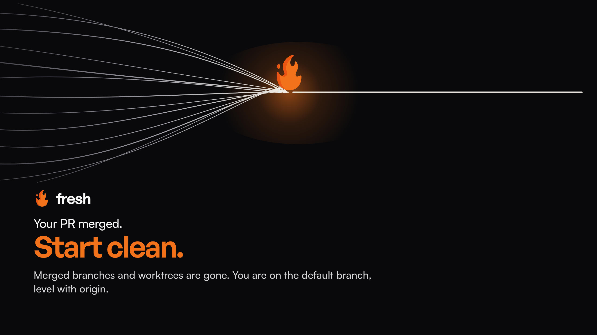
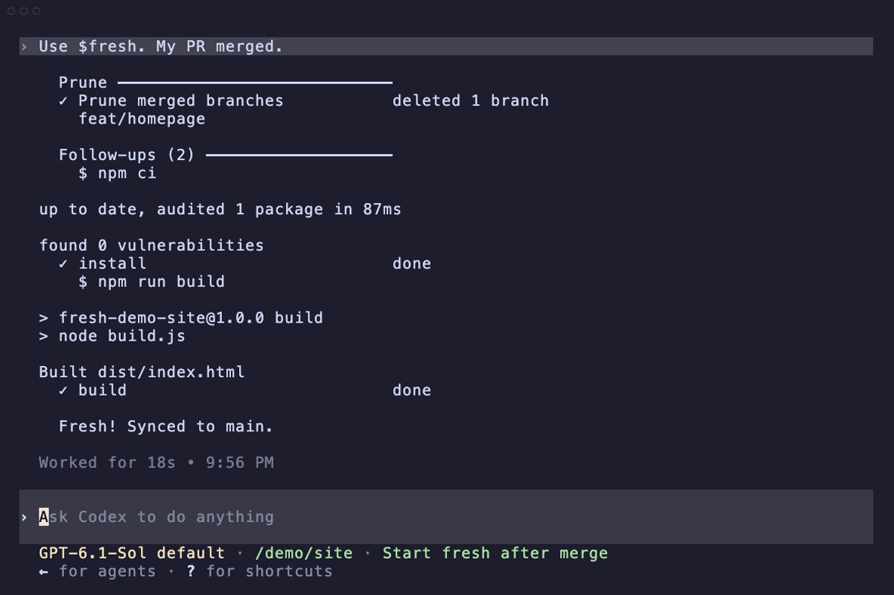
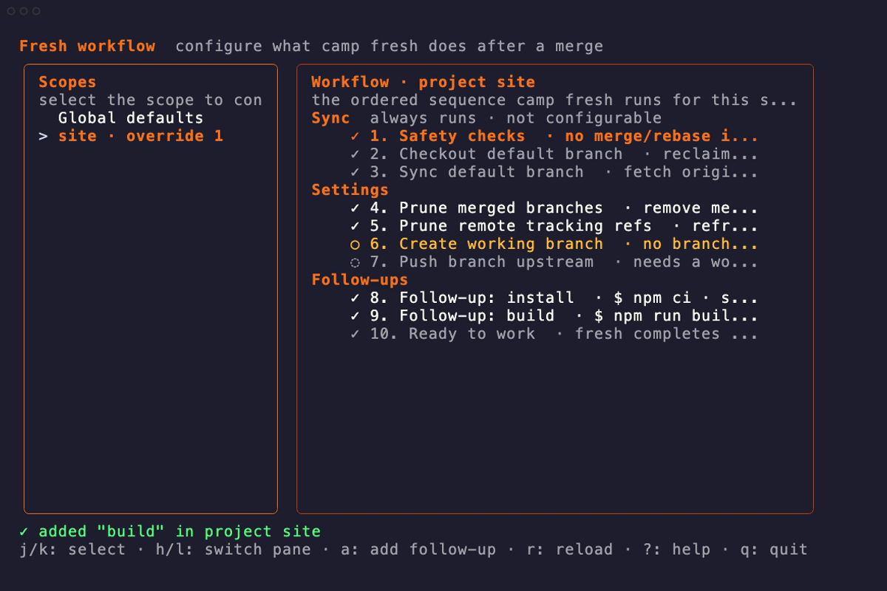
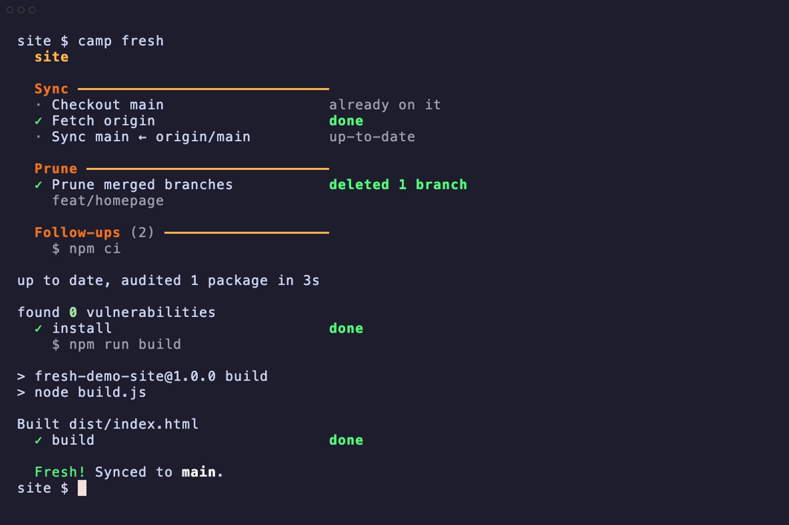

# fresh

**Your PR merged. Start clean.**

<p align="center">
  
</p>

Fresh is an agent skill that syncs your default branch and removes branches and
worktrees whose changes already landed, including squash merges. Run it through
Claude Code, Codex, Cursor, Grok, or OpenCode, or use `camp fresh` in your terminal.

You see the cleanup plan first. Uncommitted changes stop the run, and branches
with unmerged work are kept.

<p align="center">
  <a href="#install"><strong>Install Fresh</strong></a> &nbsp; · &nbsp;
  <a href="#configure-your-workflow">Watch setup</a> &nbsp; · &nbsp;
  <a href="#use-the-skill">Watch the skill</a> &nbsp; · &nbsp;
  <a href="#cli-reference">CLI reference</a>
</p>

## Install

### Claude Code

Run these inside Claude Code:

```text
/plugin marketplace add Obedience-Corp/fresh
/plugin install fresh@fresh
```

Then open your project and run `/fresh`. Use `/fresh-configure` to save commands
to run after cleanup.

### Codex

Run these in your terminal:

```bash
codex plugin marketplace add Obedience-Corp/fresh
codex plugin add fresh@fresh
```

Open Codex in your project. Type `/skills`, choose **List skills**, then select
**fresh (fresh)** and send it. Or invoke the plugin skill directly:

```text
$fresh:fresh
```

Use `$fresh:fresh-configure` to configure your workflow. Codex uses `$` for skill
mentions; `/fresh` is not a Codex command.

### Cursor, Grok, OpenCode, and other agents

Install both skills, then select your coding agents when prompted:

```bash
npx skills add https://github.com/Obedience-Corp/fresh --skill fresh fresh-configure -g
```

`-g` makes them available across your local repositories. Omit it for this project
only. Claude Code and Codex can also use this route.

Every install above includes **fresh** and **fresh-configure**. Open your project
in the agent and ask:

> Use the fresh skill. My PR merged.

On first use, the skill installs [Festival](https://github.com/Obedience-Corp/festival) if needed,
providing the `camp` command used below. It preserves developer-built binaries.
Requires macOS or Linux (WSL2 on Windows), Bash, and Python 3.

[Manual installation](docs/installation.md) · [Visual output in Claude and Codex](docs/installation.md#visual-output-in-your-agent)

## Use the skill

Select **fresh** in Codex's `/skills` picker, or type **`$fresh:fresh`** with the
plugin installed. Fresh checks Festival, previews the cleanup, then runs it and
shows the actual command output.

<p align="center">
  
</p>
<p align="center">
  <sub>Select Fresh. Preview, cleanup, and your project commands.</sub><br>
  <a href="docs/demos/videos.md#fresh-in-codex">Watch video</a> · <a href="docs/demos/skill.png">View still</a>
</p>

This is a real Codex CLI session using the installed plugin in a disposable repo.
The steps below show the terminal setup and cleanup controls it uses.

## Configure your workflow

With Festival installed, open the setup screen from your project. Add an install
step, a build, a dev server, or your own commands. Reorder steps and change branch
settings from the same screen.

```bash
camp fresh configure
```

<p align="center">
  
</p>
<p align="center">
  <sub>Add your commands. Save once. Run them after each cleanup.</sub><br>
  <a href="docs/demos/videos.md#interactive-setup">Watch video</a> · <a href="docs/demos/configured.png">View still</a>
</p>

Use the arrow keys to navigate, **Enter** to edit, and **a** to add a command.
Changes are saved from the form; configuration does not run cleanup.

Or ask your agent to use the included **fresh-configure** skill:

> Use fresh-configure. After cleanup, install dependencies and build this project.

## After your next merge

Preview what will change, then clean up. Your saved commands run after cleanup
succeeds.

```bash
camp fresh --dry-run
camp fresh
```

<p align="center">
  
</p>
<p align="center">
  <sub>Merged branch removed. Dependencies installed. Build complete.</sub><br>
  <a href="docs/demos/videos.md#cleanup-and-follow-ups">Watch video</a> · <a href="docs/demos/cleaned.png">View still</a>
</p>

Or ask your agent to use **fresh**:

> Use the fresh skill. My PR merged.

<details>
<summary>About these recordings</summary>

The skill recording runs Codex with the installed Fresh skill; the setup and
cleanup recordings run Camp directly. All use disposable demo projects with
Festival already present and a development build of Camp. These are usage demos,
not first-install recordings. [VHS tapes and reproduction steps](docs/demos/README.md).

</details>

## CLI reference

The interactive setup above is the terminal entry point. These commands are also
available for scripts, agents, or direct edits.

Festival v0.3.21 and later can link a new repo into `~/campaigns/festival`.
Camp reports the link and how `camp project unlink` undoes it. You can also link
the repo to an existing camp yourself, as described below.

<details>
<summary>Manage follow-ups, project scope, branch settings, and one-run options</summary>

You can manage the same settings directly with the CLI. Run these from a linked
project and replace `my-project` with its registered name from:

```bash
camp project list --format json
camp fresh show-workflow my-project
camp fresh show-workflow my-project --json
```

If the repo is not linked yet, link it without running cleanup:

```bash
camp project link /path/to/repo --campaign my-camp --yes --no-commit
```

### Add, edit, reorder, and remove

For a project using npm, for example:

```bash
camp fresh configure add install --run 'npm ci' --project my-project
camp fresh configure add build --run 'npm run build' --project my-project

# Change a command, keeping its position; optionally use --name to rename it.
camp fresh configure edit build --run 'npm run build:dev' --project my-project

# Move one position earlier or later.
camp fresh configure move build --up --project my-project
camp fresh configure move build --down --project my-project

camp fresh configure remove build --project my-project
camp fresh show-workflow my-project --json
```

Use any command your project needs, including `just` recipes, tests, or scripts.
`--dir apps/web` runs a step in that directory relative to the project root.
Commands run sequentially through `sh -c` after successful cleanup and branch setup.
A failing command stops later steps unless you add `--continue-on-error`. On `edit`,
resupply `--dir` and `--continue-on-error` if you want to keep them: it replaces the
whole entry. Commands in agent runs must work without interactive stdin.

A foreground server such as this keeps `camp fresh` running until the server exits:

```bash
camp fresh configure add dev --run 'npm run dev' --project my-project
```

For a service that should stay running after Fresh returns, use the project's
existing service manager or managed startup script instead. For example, a project
with a Docker Compose setup could use `--run 'docker compose up -d'`. Fresh does not
automatically detach a dev server.

### Scope, preview, and skip

Always pass `--project` for project-specific commands. Omitting it on configuration
subcommands changes the camp-wide defaults. `show-workflow` without a project name
shows those global defaults, even when run from inside a project.

A project's follow-up list **replaces** the global list. The first project `add`
starts a new list; add inherited steps explicitly if you want to retain them.
Project `edit` and `move` copy the inherited list before changing it. `remove` acts
on the stored list, and removing its last entry restores global inheritance.
Check `show-workflow my-project --json` after changes to see what will really run.
Settings are stored in the camp's `.campaign/settings/fresh.yaml`.

```bash
camp fresh configure show                     # all stored follow-up lists
camp fresh configure --project my-project     # interactive editor
camp fresh --dry-run                          # preview; follow-ups do not execute
camp fresh --no-follow-up                     # cleanup; skip follow-ups this once
```

The last command still performs cleanup. Preview it with
`camp fresh --dry-run --no-follow-up` first. Skipping does not change saved settings.

You can also manage the branch created after cleanup and upstream pushing:

```bash
camp fresh configure set branch --action branch --value feat/next --project my-project
camp fresh configure set branch --action no-branch --project my-project
camp fresh configure set branch --action inherit --project my-project
camp fresh configure set push_upstream --action off --project my-project
camp fresh configure set push_upstream --action inherit --project my-project
```

`prune` and `prune_remote` are camp-wide settings. See
`camp fresh configure set --help` before changing them. If your installed release
lacks a subcommand above, update Festival through your existing installation method.

</details>

---

<p align="center">
  <a href="docs/development.md">Development</a> ·
  <a href="https://github.com/Obedience-Corp/festival">Festival</a> ·
  <a href="LICENSE">Apache-2.0</a><br>
  Built by <a href="https://obediencecorp.com">Obedience Corp</a>.
</p>
